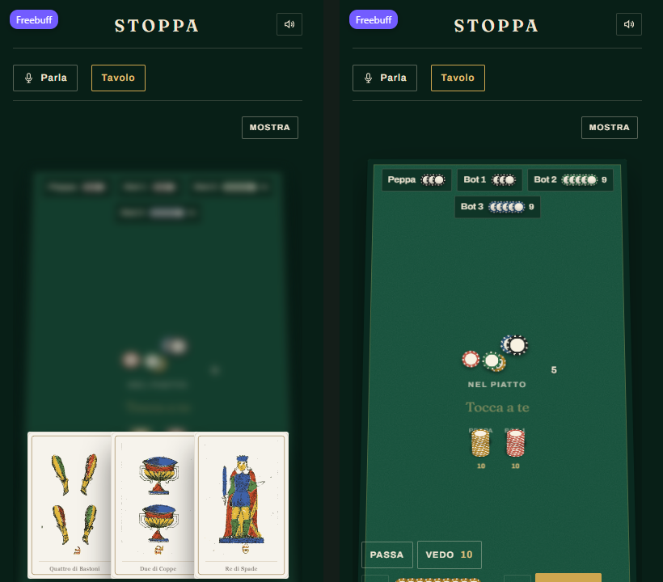
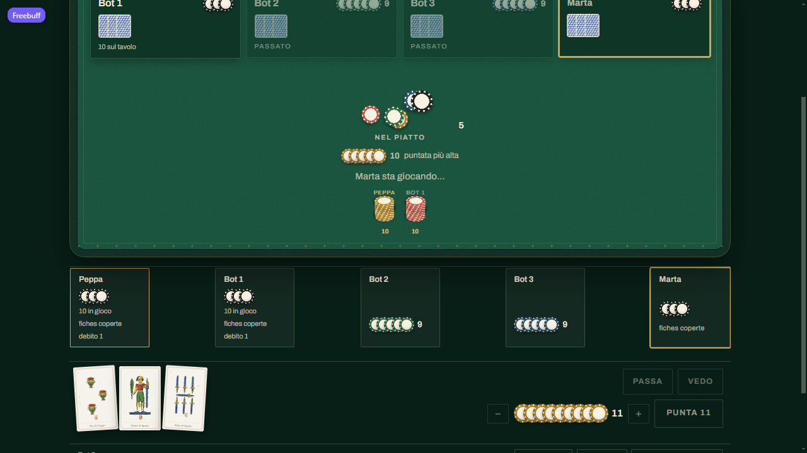
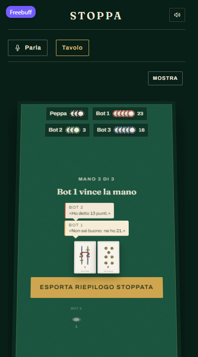
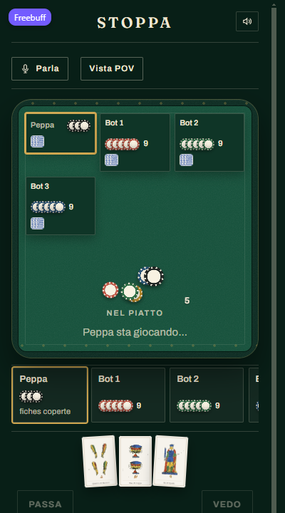
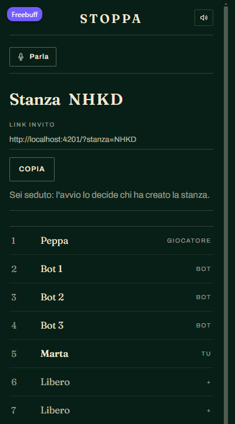

# Giro di gioco web — desktop e mobile

**Data:** 23 novembre 2026  
**Ambiente:** app Angular reale su `http://127.0.0.1:4201`, backend Spring su `:8081`,
stanza `NHKD`, due schede dello stesso browser (Peppa da desktop, Marta da mobile).  
**Partita:** 5 giocatori (Peppa, Bot 1, Bot 2, Bot 3, Marta), 3 mani (il motore con
5 giocatori prevede 3 mani), giocata fino a `finita = true`.  
**Viewport:** desktop 1280×720; mobile 390×844. Le immagini mobile sono ritagliate a
390/400 px perché lo screenshot del browser cattura l'intera finestra.

## In breve

Il gioco funziona e la sincronizzazione tra le due schede è stata reale: le puntate di
Peppa sono comparse su Marta, le risposte alle dichiarazioni si sono propagate, il turno
è passato correttamente, l'esportazione del verbale ha restituito un HTML valido.

Il problema più serio non è un conto sbagliato: è la **POV mobile**, dove le carte e i
comandi non possono essere visti insieme. Con le carte alzate il tavolo è sfocato e i
comandi sono invisibili; con il tavolo chiaro i comandi compaiono ma le carte spariscono.
In pratica si gioca a memoria. A questo si aggiungono il tetto dei 10 gettoni che produce
“Punta 11”, la possibilità di azzerare una mano aperta senza conferma e l'assenza di una
schermata finale con classifica.

| Gravità | Problemi |
| --- | --- |
| Alta | POV carte/comandi mutuamente esclusivi; nessuna fiche propria in POV; “Punta 11” a tetto 10; “Nuova partita” azzera a mano aperta; nessuna classifica finale; il non-creatore resta in lobby all'avvio |
| Media | “Prossima mano” chiamabile da tutti; “Nuova partita” visibile a tutti (409); dichiarazione precompilata a 20; comandi visibili a mano chiusa; POV predefinita anche su desktop; mano e comandi sotto la piega a 1280×720; nessun punto durante le puntate; tabella mobile stretta |
| Bassa | Posti POV 3+1; lobby senza selettore “5 giocatori”; rimozione posti con un clic; “Carte a testa 3”; eventi in prima persona; apostrofo ASCII negli errori |



A sinistra le carte alzate: tavolo sfocato, nessun comando. A destra il tavolo chiaro:
comandi visibili, carte sparite. Stessa mano, stesso momento.

## Cosa ha funzionato

- **Due client reali**: la stanza è stata creata da Peppa, Marta è entrata dal link
  `?stanza=NHKD`; le due schede hanno visto le stesse puntate, lo stesso piatto e gli
  stessi eventi.
- **Puntate e turni**: nella mano 1 Peppa ha puntato 2, i bot hanno visto 2, Marta ha
  visto 2; nella mano 2 i bot hanno puntato 3, Marta ha visto 3 e Peppa ha visto 3. Il
  turno è sempre passato al giocatore giusto.
- **Dichiarazioni**: mano 1 Peppa dichiara 31, Bot 3 contesta con 37 → `non-sei-buono`,
  vince Bot 3. Mano 2 Bot 1 dichiara 24, Peppa accetta, Marta accetta → `buono`, vince
  Bot 1. Mano 3 Bot 2 dichiara 13, Bot 1 contesta con 21 → vince Bot 1.
- **Fiches**: “Mostra” rende visibili le fiches di Peppa anche a Marta (4), “Copri” le
  nasconde di nuovo; il valore predefinito resta coperto.
- **Esportazione**: “Esporta Riepilogo Stoppata” ha prodotto
  `stoppa-NHKD.html` (blob, HTTP 200, 2.1 kB) con il riepilogo della partita.
- **Riavvio**: “Nuova partita” ricrea la mano 1 con gli stessi cinque posti.
- **Layout**: a 390 px la pagina non sborda orizzontalmente; font e carte si caricano;
  la tabella desktop resta leggibile; il toggle “Vista POV” / “Tavolo” funziona.

## Problemi trovati

### G1 — POV: le carte e i comandi si escludono (alta)

È il difetto principale. In `styles.css`:

```css
.pov.chiaro .pov-mano {
  opacity: 0;
  transform: translateY(130%);
  pointer-events: none;
}
.pov-comandi {
  opacity: 0;
  pointer-events: none;
}
.pov.chiaro .pov-comandi {
  opacity: 1;
  pointer-events: auto;
}
```

La POV parte in `alzate`: il tavolo è sfocato (`filter: blur(5px)`) e i comandi hanno
`opacity: 0` e `pointer-events: none`. Dopo un trascinamento verso il basso di almeno
30 px diventa `chiaro`: i comandi compaiono e la mano viene trasformata fuori schermo.
Non esiste uno stato in cui si vedono insieme le proprie carte e i pulsanti Passa/Vedo/
Punta. Il suggerimento dice solo “Scorri giù per vedere il tavolo”; non dice che le
carte spariscono né che i comandi sono sotto il gesto.

Verificato con i computed style: `pov.chiaro` → `.pov-mano opacity 0`,
`.pov-comandi opacity 1`; `pov.alzate` → mano `opacity 1`, comandi `opacity 0`.
La schermata affiancata qui sopra è la prova visiva.

**Effetto:** sul telefono si punta e si dichiara senza vedere la propria mano; chi non
scopre il gesto non trova i comandi. È il primo punto da correggere.

### G2 — Nella POV non ci sono le proprie fiches, il debito o il proprio nome (alta)

La POV mostra solo `avversari()`; la striscia con tutti i giocatori (`striscia`) esiste
solo nella vista non-POV. Marta, che aveva 7 e poi 4 gettoni, non ha mai visto il proprio
saldo nella POV; la schermata mostra solo Peppa, Bot 1, Bot 2 e Bot 3. Mancano anche il
debito e il proprio nome. Anche nella vista “Tavolo” la sua scheda era oltre il bordo
destro della striscia orizzontale, quindi il saldo non era visibile senza trascinare.

### G3 — Con la puntata massima a 10 il client propone “Punta 11” (alta)

Riprodotto dal vivo:

1. Peppa punta 10 (dopo aver portato lo stepper a 10).
2. Bot 1 vede 10; Bot 2 e Bot 3 passano.
3. Tocca a Marta. Lo stato dice `puntataMassima = 10` e `puntataMinima = 11`.
4. La POV (e la tabella) mostrano `Vedo 10`, `−` e `+` **disabilitati**, e
   `Punta 11` **abilitato**.
5. Clic su “Punta 11” → il server risponde
   `409 si punta da 1 a 10 gettoni, non 11`.



Il pulsante `Punta 11` è oro anche se disabilitato per chi non è di turno; lo stepper
mostra 11 gettoni a tutti. La causa è `puntataMinima = max + 1` senza limite a 10:
`applica()` corregge `puntata` a 11, ma il massimo resta 10; `−` e `+` si bloccano
entrambi e l'unica azione rimasta è Vedo o Passa. Il server è corretto; il client no.

### G4 — “Nuova partita” azzera una mano aperta, senza conferma (alta)

Riprodotto nella mano 1: dopo “Passi” e le puntate dei bot lo stato aveva 4 eventi
(`Bot 3 punta 3`, `Bot 2 passa`, `Bot 1 passa`, `Passi`) e `chiusa = false`. Un clic su
“Nuova partita” ha riportato la partita a mano 1 con il solo evento
`Carte distribuite · 3 mani`, senza dialogo. Anche a partita finita il clic ricomincia
subito, senza chiedere.

Il controllo del creatore è solo lato server; l'interfaccia mostra il pulsante a tutti.
Non c'è `window.confirm`, non c'è undo. Chi crea la stanza può cancellare la partita in
corso per sbaglio; chi non la crea riceve un 409.

### G5 — La partita finisce senza classifica né “Partita finita” (alta)

Dopo la mano 3 lo stato è `finita = true`, ma la schermata mostra ancora l'esito
dell'ultima mano e il pulsante “Esporta Riepilogo Stoppata”. Non c'è un titolo di fine
partita, non c'è il vincitore della partita, non c'è la classifica con fiches/debiti/
cambi: quei dati esistono solo nel file esportato. Sul desktop il pannello finale è
sotto la piega; sulla POV mobile si vede solo l'export.

Inoltre, sull'ultima mano il pulsante centrale dice ancora **“Prossima mano”**: solo
dopo averlo premuto `finita` diventa true. Un giocatore non sa che quella era l'ultima
mano e non sa che il clic chiuderà la partita.



### G6 — Il non-creatore resta in lobby quando parte la partita (alta)

All'avvio di Peppa, la scheda di Marta è rimasta sulla lobby con
“Partita iniziata: si torna al tavolo” e il pulsante “Torna al tavolo”; non è passata
automaticamente al tavolo. Su mobile bisogna trovare e premere quel pulsante, che è in
fondo alla pagina. Il tavolo è già pronto e la partita è iniziata: l'attesa manuale è
un attrito inutile e sembra che l'ingresso non abbia funzionato.

### G7 — “Prossima mano” la può premere chiunque (media)

Dopo la mano 1, con Peppa cartaro, è stata **Marta** a premere “Prossima mano” dalla POV
mobile; la mano 2 è partita regolarmente. Il server accetta la richiesta da qualsiasi
sessione della stanza (già verificato via REST) e l'interfaccia mostra il pulsante a
tutti. Non corrompe lo stato, ma il comando del tavolo è ambiguo e due giocatori possono
premere insieme: il secondo riceve `409 la mano X è ancora aperta`.

### G8 — “Nuova partita” è visibile anche a chi non è creatore (media)

Nella vista “Tavolo” di Marta (non creatrice) il pulsante “Nuova partita” è presente.
Il clic produce `409 solo chi crea la lobby puo' ricominciare`, mostrato in un messaggio
di errore. Il pulsante dovrebbe essere nascosto o disabilitato per i non-creatori.
Nota di copy: `puo'` usa l'apostrofo ASCII, mentre il resto dell'interfaccia usa
l'apostrofo tipografico.

### G9 — La dichiarazione parte da 20, non dal proprio punto (media)

Nella POV di Peppa la schermata di dichiarazione mostrava:

```text
Il tuo punto: 31.
[−] [ 20 ] [+] [Dichiara]
```

Il valore iniziale è fisso a 20 (`dichiarazione = signal(20)`), anche quando il punto è
31. Chi non controlla il campo e preme “Dichiara” dichiara 20, cioè un bluff, e rischia
di perdere la mano. Il default dovrebbe essere il punto reale (o l'ultima dichiarazione),
non un numero arbitrario. Il campo numerico è piccolo e il valore “20” non è evidenziato.

### G10 — A mano chiusa la POV lascia la barra dei comandi (media)

La barra `.pov-comandi` è racchiusa in:

```html
@if (!s.finita && !s.mano.inDichiarazione) { ... }
```

Manca `!s.mano.chiusa`. Quando la mano si chiude, `applica()` abbassa le carte, quindi la
POV passa a `.chiaro` e la barra Passa/Vedo/Punta (disabilitata) compare sotto
“Prossima mano”. Nella mano 2 e nella mano 3 la barra era ancora lì, con tutti i pulsanti
disabilitati. Nella vista non-POV la mano propria è già nascosta con
`@if (!s.mano.chiusa)`; la POV non ha la stessa condizione.

### G11 — Su desktop la POV è la vista predefinita e sembra un telefono (media)

`Vista.pov = true` vale anche a 1280 px: chi apre il tavolo da PC vede la POV, cioè un
tavolo largo 900 px con ampi margini, il tavolo sfocato e i comandi nascosti dal gesto.
Per vedere il tavolo completo deve trovare “Vista POV” in alto e cambiare vista. La POV
è pensata per il telefono; su desktop il default dovrebbe essere la vista “Tavolo”, o
almeno la scelta dovrebbe dipendere dal breakpoint.

### G12 — A 1280×720 la mano e i comandi sono sotto la piega (media)

Nella vista “Tavolo” la pagina è alta 1068 px; a 1280×720 la mano propria comincia a
`y ≈ 793` e la striscia comandi a `y ≈ 925`. Il tavolo occupa quasi tutta la prima
schermata; per giocare bisogna scorrere. A 900 px di altezza la mano era ancora 11 px
sotto il bordo. Non è un blocco (la pagina scorre), ma l'azione principale non è dove
l'occhio la cerca. La POV desktop è ancora più stretta e nasconde i comandi.

### G13 — Durante le puntate il proprio punto non è visibile (media)

Il punto della mano compare solo nella schermata di dichiarazione
(“Il tuo punto: 31”). Durante le puntate non c'è né nella POV né nella tabella. Chi
punta non può valutare la forza della mano; deve ricordarsela o aspettare la
dichiarazione. Se è una scelta di gioco, va spiegata; altrimenti è un dato mancante.

### G14 — La tabella mobile è stretta e la propria scheda può essere fuori schermo (media)

A 390 px la vista “Tavolo” dispone i quattro avversari in 3+1, poi la striscia
orizzontale con tutti i giocatori. La striscia parte da Peppa, Bot 1, Bot 2… e la scheda
di Marta (la propria) è oltre il bordo destro: per vedere le proprie fiches bisogna
trascinare la striscia. La POV non le mostra affatto (G2). Il tavolo è molto più stretto
della POV e le carte in mano stanno in una riga che richiede attenzione.



### G15 — In lobby manca un selettore per 5 giocatori (media)

La stanza nasce con il creatore e cinque bot (6 posti). Per giocare in 5 si devono
togliere due bot uno per uno; non c'è un selettore “numero giocatori”. Ogni posto è un
`<button>`: un clic rimuove subito il bot o l'umano, senza conferma né annulla. Se si
toglie un bot interno, i nomi restano `Bot 1`, `Bot 3`… (i bot non vengono rinumerati).
La rimozione è reversibile solo aggiungendo un nuovo bot, che prende il nome successivo.
In una prova precedente, togliendo un bot interno i nomi sono rimasti `Bot 1` e `Bot 5`,
con un buco nella numerazione.



### G16 — “Carte a testa 3” in home è ancora sbagliato (bassa)

Con 5 giocatori le carte a testa sono 8 (3+3+2 per mano). La home mostra ancora
“Carte a testa 3”. Il 3 è il massimo per mano, non per giocatore. Andrebbe scritto
“fino a 3 per mano” o calcolato dal numero di giocatori.

### G17 — Il registro eventi non dice chi fa le azioni umane (bassa)

Nel registro condiviso si legge `Passi`, `Vedi`, `Punti 3`, `Dichiari 31`, mentre i bot
hanno il nome (`Bot 1 passa`, `Bot 3 vede`). Nel giro di Peppa e Marta non si distingue
chi ha passato o visto. Il server conosce la sessione: manca solo il nome nel testo
dell'evento.

### G18 — POV con 5 giocatori: quattro avversari in 3+1 (bassa)

A 390 px i quattro avversari stanno su due righe: Peppa/Bot 1/Bot 2, poi Bot 3 da solo.
La griglia non è bilanciata (2+2 sarebbe più ordinato) e lascia uno spazio vuoto a
destra. Non impedisce il gioco, ma la POV sembra “rotta” a prima vista.

## Passi per riprodurre

```bash
# backend
cd backend
JAVA_HOME=/home/peppa/.sdkman/candidates/java/25.0.5.0+8-tem \
  ./mvnw -B -q -DskipTests package
/home/peppa/.sdkman/candidates/java/25.0.5.0+8-tem/bin/java \
  -jar target/stoppa-backend-0.0.1-SNAPSHOT.jar --server.port=8081

# frontend su una porta libera, con proxy verso 8081
cd frontend
npx ng serve --port 4201 --host 127.0.0.1 --proxy-config /tmp/proxy-8081.json
```

Poi:

1. Scheda desktop: nome `Peppa` → “Crea una stanza”.
2. Scheda mobile: `http://127.0.0.1:4201/?stanza=CODICE`, nome `Marta` → “Entra con il
   codice”; nella lobby di Peppa restano 5 posti (togliere i bot in eccesso).
3. “Avvia partita”; su Marta premere “Torna al tavolo”.
4. Giocare 3 mani: puntare, vedere, dichiarare, accettare/contendere; “Prossima mano”
   alla fine di ogni mano. La terza mano termina la partita.
5. Per G3: nella mano 1 Peppa porta lo stepper a 10 e punta; quando tocca a Marta
   compariranno `puntataMinima = 11`, `Punta 11` e il 409.
6. Per G4: a mano aperta, “Nuova partita” nel registro della vista “Tavolo”.
7. Per G1: nella POV mobile trascinare giù per vedere i comandi e osservare che le
   carte spariscono; trascinare su per riaverle e osservare che i comandi spariscono.

## Cosa non è stato verificato

- **Dispositivo fisico / Safari iOS**: il mobile è emulato a 390×844 nel browser di test;
  lo screenshot cattura la finestra a 720 px di altezza, poi ritagliata a 390.
- **Voce**: il pulsante “Parla” non è stato usato (serve microfono e permessi).
- **PIN e link su un secondo dispositivo**: la stanza è stata raggiunta con il link nella
  stessa macchina, senza PIN.
- **Reload e riconnessione**: non ho ricaricato le schede durante la partita. Le due
  schede del browser di test condividono parte dello storage; non è una prova di due
  browser separati.
- **8 giocatori**: solo 5.
- **Audio**: suoni non valutati.
- **Build di produzione / Lighthouse**: no.
- **Test automatici frontend**: non eseguiti; il codice non è stato modificato.

## Priorità consigliate

1. **POV**: rendere visibili insieme carte e comandi (barra fissa in basso, o tavolo
   dietro le carte senza nasconderle); aggiungere le proprie fiches/debito.
2. **Tetto 10**: `puntataMinima = min(max + 1, 10)` e “Punta” disabilitato a 10;
   non mostrare 11 a chi non è di turno.
3. **Nuova partita**: solo a partita finita, solo creatore, con conferma; nasconderla
   agli altri.
4. **Fine partita**: schermata con “Partita finita”, vincitore e classifica; sull'ultima
   mano il pulsante deve dire “Fine partita”.
5. **Dichiarazione**: precompilare con il proprio punto (o l'ultima dichiarazione).
6. **Prossima mano**: limitarla al cartaro o renderla idempotente; nasconderla agli altri.
7. **Lobby**: selettore numero giocatori, rimozione con conferma, nomi bot coerenti.
8. **Copy e registro**: “Carte a testa”, nomi negli eventi, apostrofi.

## Materiale

- [`qa-pov-scambio.png`](qa-pov-scambio.png) — POV con carte vs POV con comandi.
- [`qa-tavolo-desktop-basso.png`](qa-tavolo-desktop-basso.png) — tavolo desktop con
  “Punta 11” e la mano sotto la piega.
- [`qa-tavolo-mobile-390.png`](qa-tavolo-mobile-390.png) — vista Tavolo a 390 px.
- [`qa-lobby-mobile-390.png`](qa-lobby-mobile-390.png) — lobby a 390 px.
- [`qa-fine-mobile-390.png`](qa-fine-mobile-390.png) — fine partita nella POV.
- [`qa-fine-desktop.png`](qa-fine-desktop.png) — fine partita nella vista Tavolo.
- [`qa-lobby-desktop.png`](qa-lobby-desktop.png) — lobby desktop (7 posti, prima della
  riduzione a 5).
