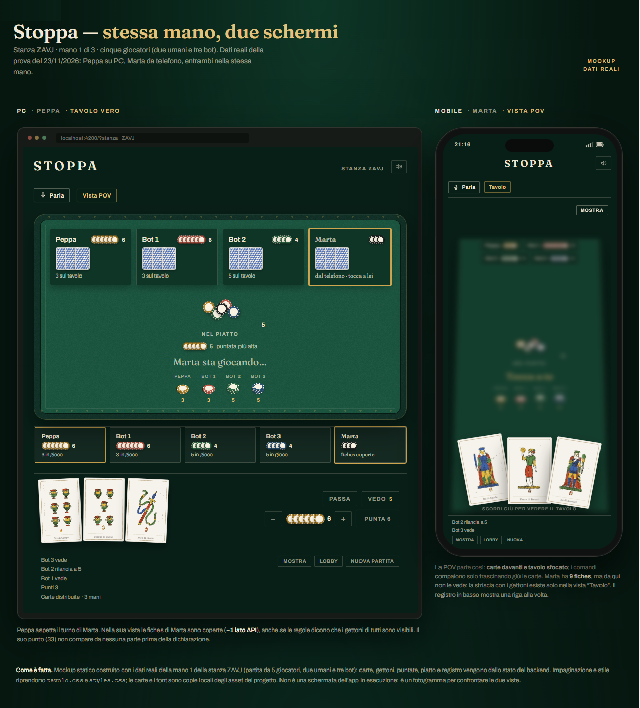

# Prova partita a 5 giocatori — 23 novembre 2026

Partita reale giocata contro il backend in esecuzione, non una simulazione: due sessioni
umane (Peppa, creatrice, e Marta, entrata col codice) più tre bot, cinque posti in tutto.
Il copione ha giocato **5 mani** per profilo, per tre profili, e ha controllato carte,
punti, fiches, piatto, debiti e cambi dopo ogni mano.



## In breve

| Cosa | Esito |
| --- | --- |
| Conti (fiches, piatto, debiti, cambi) | **coerenti** in tutte le 15 mani |
| Punti delle mani e delle carte vincenti | **coerenti** con il calcolo indipendente |
| Carte in mano e distribuzione | **coerenti** per i due umani (8 a testa, 3+3+2) |
| Errori API provati (6 casi) | tutti **409** con messaggio chiaro |
| Mani per partita con 5 giocatori | **3, non 5** → per fare 5 round serve una seconda partita |
| Problemi grafici trovati | 12, dai comandi mobile al tetto di 10 gettoni |
| Controlli automatici | **327** (109 × 3 profili), **0 falliti** |

La schermata affiancata è in [`partita-5-duo.html`](partita-5-duo.html) (autosufficiente,
carte e font incorporati) e in [`partita-5-duo.png`](partita-5-duo.png). È un fotogramma
della **mano 1 della stanza ZAVJ**: Peppa su PC, Marta da telefono, stessi gettoni e stesse
puntate.

### Perché "5 round" ha richiesto due partite

Con 5 giocatori il mazzo dà 8 carte a testa e le divide in **3+3+2**: il motore calcola
`maniTotali = 3`. Il copione ha quindi giocato la partita 1 per intero (3 mani) e le prime
2 mani della partita 2, per un totale di 5 round. È il primo punto del report, non un
dettaglio del test.

## Come è stata fatta la prova

- Backend ricostruito dal sorgente e avviato su `:8081` (la 8080 era occupata).
- Stanza creata da Peppa, ingresso di Marta, rimozione di due bot per restare in cinque:
  `Peppa, Bot 1, Bot 2, Bot 3, Marta`.
- Tre profili, stessa seed logica ma scelte diverse:
  - **normale** (`ZAVJ`): puntate miste, dichiarazioni per lo più vere.
  - **bluff** (`NFWY`): dichiara 55 finché il tetto dei bluff lo consente, poi la verità.
  - **aggressivo** (`TFFT`): punta 10 appena può, per portare i giocatori a debito e cambio.
- Dati grezzi: [`prova-5-giocatori.json`](prova-5-giocatori.json),
  [`prova-5-giocatori-bluff.json`](prova-5-giocatori-bluff.json),
  [`prova-5-giocatori-aggressivo.json`](prova-5-giocatori-aggressivo.json).
- Verbale della partita 1 del profilo aggressivo (9 cambi):
  [`verbale-prova-5-giocatori.html`](verbale-prova-5-giocatori.html).
- Copione riproducibile: [`../scripts/prova-partita.py`](../scripts/prova-partita.py).

```bash
cd backend
JAVA_HOME=/home/peppa/.sdkman/candidates/java/25.0.5.0+8-tem ./mvnw -B -q -DskipTests package
/home/peppa/.sdkman/candidates/java/25.0.5.0+8-tem/bin/java \
  -jar target/stoppa-backend-0.0.1-SNAPSHOT.jar --server.port=8081

cd ..
python3 scripts/prova-partita.py --base http://localhost:8081
python3 scripts/prova-partita.py --base http://localhost:8081 --profilo bluff --seed 11 \
  --out docs/prova-5-giocatori-bluff.json
python3 scripts/prova-partita.py --base http://localhost:8081 --profilo aggressivo --seed 23 \
  --out docs/prova-5-giocatori-aggressivo.json
```

Ogni esecuzione crea una stanza nuova; i file JSON sovrascrivono quelli del profilo
corrispondente, quindi vanno rilanciati con gli stessi nomi.

## Backend

### B1 — Con 5 giocatori la partita è di 3 mani, non di un giro da 5

**Gravità: alta (di prodotto).** È il motivo per cui la richiesta "5 round" non si può
soddisfare in una sola partita.

- `Mazziere.tagli(8)` produce `[3, 3, 2]`; `Distribuzione.numeroMani()` vale 3 e
  `Partita.maniTotali()` restituisce 3.
- Nei cinque round giocati i cartari sono stati: **Peppa, Bot 1, Bot 2, Peppa, Bot 1**.
  Bot 3 e Marta non hanno mai fatto il cartaro. Le regole dicono che il cartaro ruota a
  ogni mano, ma con 5 posti e 3 mani il giro non passa da tutti.
- La stessa cosa vale per 6, 7 e 8 giocatori (2 mani): solo con 4 giocatori (4 mani) tutti
  fanno il cartaro almeno una volta.

Da decidere: se "giro completo" significa 5 mani, bisogna cambiare la distribuzione (per
esempio 5 mani da 2, 2, 2, 1, 1 carte) o accettare che la partita duri 3 mani e chiamare
"giro" quello che il motore già fa. Oggi il nome "giro completo" non corrisponde al numero
di giocatori.

### B2 — Gli eventi delle mosse umane non dicono chi le ha fatte

**Gravità: media.** Il registro è condiviso, ma il server registra le azioni in prima
persona:

```text
Bot 3 vede
Bot 2 rilancia a 5
Bot 1 vede
Punti 3
Carte distribuite · 3 mani
```

`Punti 3` è di Peppa, ma non c'è scritto. Lo stesso vale per `Vedi`, `Passi`, `Punti N`,
`Dichiari N`, `Accetti`, `Contesti`; i bot invece hanno il nome (`Bot 1 contesta`).
`TavoloService` conosce la sessione e il posto: basta aggiungere il nome. In una stanza
con più umani il registro è ambiguo proprio quando serve.

### B3 — L'esito `accettata` non è raggiungibile

**Gravità: bassa (codice morto).** In `Mano.accetta`:

- se la dichiarazione è vera → `buono` e vince il dichiarante;
- se è un bluff e `bluff < 3` → incrementa e riapre la dichiarazione;
- altrimenti → `accettata` e vince il dichiarante.

Ma `Mano.dichiara` vieta un bluff quando `bluff >= 3`: l'unica dichiarazione possibile
dopo il terzo bluff accettato è quella vera, che viene gestita dal primo ramo. In 15 mani
non è mai comparso `accettata`; il ramo corrispondente in `tavolo.html` è morto. Non è
pericoloso, ma va o rimosso o reso raggiungibile con una regola esplicita.

### B4 — I bot rendono la dichiarazione prevedibile

**Gravità: media (game design).** `dichiarazioneBot` dichiara solo `reali + 0..2` (mai
sotto il vero) e contesta ogni volta che `reali >= dichiarazione`. Nei profili normale e
bluff **4 mani su 5** sono finite `non-sei-buono`; nel profilo normale l'unico `buono` è
arrivato quando il dichiarante aveva il punto più alto. Per far girare il ciclo dei bluff
il copione ha dovuto dichiarare 55 per tre volte di fila: i bot, non potendo contestare,
accettavano tutti.

Non è un errore di correttezza, ma la meccanica della dichiarazione a voce diventa una
formalità. Servirebbe un misto di accettazioni e contestazioni, e qualche bluff al ribasso.

### B5 — "Nuova partita" azzera una mano aperta

**Gravità: alta (perdita di dati).** `TavoloService.nuovaPartita` controlla solo che la
sessione sia del creatore, non che la partita sia finita. Verificato a mano:

```text
GET  /api/tavolo/NDTE      → mano 1, chiusa=false
POST /api/tavolo/NDTE/nuova → 200, mano 1, eventi azzerati
```

Il pulsante "Nuova partita" è sempre visibile nel registro (anche a mano aperta) e non
chiede conferma. Un clic del creatore butta via la partita in corso. Serve un controllo
`partita.finita()` oppure una conferma esplicita, e il pulsante va nascosto a chi non è
creatore.

### B6 — "Prossima mano" la può chiedere chiunque

**Gravità: bassa/media.** `TavoloService.prossimaMano` accetta qualsiasi sessione della
stanza, non solo il cartaro o il creatore. Il pulsante è mostrato a tutti. Con due umani
entrambi possono premere: il primo avanza, il secondo riceve
`409 la mano X è ancora aperta`. Non corrompe lo stato (la mano nuova non può chiudersi
prima che un umano giochi), ma produce un errore inutile e rende ambiguo chi comanda il
tavolo. Se è voluto, l'interfaccia deve dirlo; altrimenti va limitato o reso idempotente.

### B7 — La chiusura di un socket può lanciare un'eccezione non gestita

**Gravità: media/bassa.** `mvnw verify` passa (exit 0), ma nei log compare:

```text
Unhandled exception after connection closed
java.lang.IllegalStateException: Message will not be sent because the WebSocket session has been closed
  at LobbyWebSocketHandler.inviaTesto(LobbyWebSocketHandler.java:367)
  at LobbyWebSocketHandler.annunciaVoci(LobbyWebSocketHandler.java:302)
  at LobbyWebSocketHandler.scollega(LobbyWebSocketHandler.java:216)
  at LobbyWebSocketHandler.afterConnectionClosed(LobbyWebSocketHandler.java:85)
```

`inviaTesto` controlla `socket.isOpen()` e cattura solo `IOException`; Tomcat può lanciare
`IllegalStateException` nella corsa tra il controllo e `sendMessage`. Alla chiusura di un
socket con microfono acceso, `scollega` annuncia il roster agli altri e prova a scrivere
anche al socket appena chiuso. Non rompe la partita, ma sporca i log e può interrompere
la pulizia del roster. Catturare `RuntimeException` in `inviaTesto`, oppure togliere la
voce prima dell'annuncio.

### Cosa invece torna

- **Carte**: 15 carte sul tavolo nelle mani 1 e 2, 10 nella mano 3 (5 giocatori × 3/3/2).
  8 carte a testa per partita, nessun duplicato tra le carte viste dai due umani, nessuna
  carta in comune tra Peppa e Marta nella stessa mano.
- **Punti**: `tuoiPunti` coincide con il calcolo indipendente della primiera in tutte le
  mani viste (29, 15, 16, 31, 28, 21, 22, 18, …); `puntiVincenti` coincide con il punto
  delle carte vincenti in tutte le 15 mani.
- **Conti**: dopo ogni mano `somma(fiches) + piatto = 50 + 10 × cambi`; per ogni
  giocatore `fiches = 10 − giocati + incassati + 10 × cambi`; `debito = max(0, −fiches)`.
  Nel profilo aggressivo la partita 1 chiude con **9 cambi** e 140 fiches in giro
  (50 + 90), senza perdite. A fine partita il piatto va a 0.
- **Errori**: codice stanza inesistente, prossima mano a mano aperta, nuova partita da
  non creatore, puntata 11, dichiarazione 56, risposta senza dichiarazione: tutti `409`
  con messaggio leggibile.
- **Fiches**: `mostra-fiches` funziona (Marta vede 9 dopo che Peppa mostra, −1 dopo che
  Peppa copre). Il problema è il valore predefinito, non l'endpoint.
- **Suite backend**: `./mvnw -B -q verify` esce con 0. L'unico rumore è l'eccezione di
  B7, che il test non fa fallire.

### Limiti della prova

- I due umani sono pilotati via REST, non da due browser: il WebSocket non è stato
  esercitato in questa prova. Lato server REST e socket passano dallo stesso
  `TavoloService`, ma la sincronizzazione a due client resta da verificare a schermo.
- Le carte dei bot non sono visibili per definizione: l'integrità del mazzo è verificata
  per i due umani e per i conteggi (15/15/10), non carta per carta su tutti i 40.
- La schermata duo è un mockup statico con dati reali, non un click-through dell'app.

## Frontend

### F1 — Su mobile i comandi sono nascosti dietro un gesto

**Gravità: alta.** La POV è la vista predefinita (`Vista.pov = true`) e parte con le
carte alzate: `.pov.alzate .pov-tavolo` sfoca il tavolo, `.pov-comandi` ha `opacity: 0` e
compare solo con `.pov.chiaro`, cioè dopo un trascinamento verso il basso di almeno 30 px.
L'unico indizio è la scritta "Scorri giù per vedere il tavolo". Nella schermata duo la
POV mostra esattamente questo: carte in mano, tavolo sfocato, nessun comando. Passa,
Vedo e Punta non sono raggiungibili senza il gesto (e non c'è alternativa da tastiera).

Consiglio: barra azioni sempre visibile in basso, oppure un pulsante "Gioca" esplicito;
il gesto può restare come scorciatoia, non come unico accesso.

### F2 — Nella POV non si vedono le proprie fiches

**Gravità: alta.** Il ramo POV di `tavolo.html` mostra solo gli avversari
(`pov-avversari` esclude `tuoIndice`), le proprie carte e il pulsante Mostra/Copri. La
striscia con i gettoni di tutti (`striscia`) esiste solo nella vista non-POV. Marta, che
ha 9 fiches, dal telefono non ha nessun punto della schermata in cui leggerlo. Mancano
anche debito e nome del posto. Va aggiunto il conto vicino alla mano o nella testata.

### F3 — Le fiches degli altri umani sono coperte per default

**Gravità: media/alta.** Il server manda `fiches = -1` per un umano che non ha scelto
`mostra-fiches`; il client disegna tre fiches coperte e la nota "fiches coperte". I bot
sono sempre visibili. Verificato: nella vista di Marta, Peppa vale `-1`; dopo il comando
di Peppa vale 9; dopo "copri" torna `-1`. `RULES.md` dice che i gettoni di tutti sono
visibili e il README dice che il pulsante a occhio non è ancora implementato: la
documentazione e il comportamento attuale non coincidono. Decidere una regola sola
(default visibile, oppure default coperto con documentazione aggiornata).

### F4 — A 10 gettoni la stepper propone "Punta 11"

**Gravità: alta (errore visibile).** `StatoTavolo` espone
`puntataMinima = mano.puntataMassima() + 1` e `puntataMassima = 10`. Quando la puntata
più alta è 10, il client riceve minima 11 e massima 10; `applica()` corregge il valore a
11 e il pulsante "Punta 11" resta abilitato. Il server risponde
`409 si punta da 1 a 10 gettoni, non 11` (provato). In più `+` è disabilitato perché
`puntata >= massima` e `−` è disabilitato perché `puntata <= minima`: si resta fermi su
11 e si può solo Vedo o Passa.

Correzione: `puntataMinima = Math.min(max + 1, 10)` e pulsante Punta disabilitato quando
`max === 10`; il server può anche restituire un flag "rilancio chiuso".

### F5 — "Carte a testa 3" in home è sbagliato

**Gravità: media (dato falso).** Con 5 giocatori le carte a testa sono **8**; con 4 sono
10, con 6 sono 6, con 7 e 8 sono 5. Il 3 è il massimo per **mano**, non per giocatore.
La riga `dati-partita` della home dice "Carte a testa 3" e va corretta in "fino a 3 per
mano" oppure resa dinamica.

### F6 — "Nuova partita" è distruttiva e visibile a tutti

**Gravità: alta (dati).** Il pulsante è sempre nel registro; il creatore può azzerare la
partita anche a mano aperta (B5) senza conferma; un non creatore riceve
`409 solo chi crea la lobby può ricominciare`. Va mostrato solo a partita finita, solo al
creatore, con conferma.

### F7 — In lobby si toglie un posto con un clic, e i bot restano numerati a buchi

**Gravità: media.** Ogni posto occupato è un `<button>`: un clic rimuove subito il bot o
l'umano, senza conferma né annulla. Nel test, rimuovendo gli indici 4, 3 e 2 la stanza è
rimasta con `Bot 1` e `Bot 5`: i nomi non vengono rinumerati, quindi il tavolo mostra
buchi. Inoltre per creare una partita da 5 si parte da 6 posti (tu + 5 bot) e si devono
togliere due bot uno per uno; non c'è un selettore "numero giocatori". L'istruzione c'è,
ma il gesto è poco scopribile.

### F8 — Il registro su mobile mostra una riga

**Gravità: media.** `.registro-righe` ha `max-height: 1.7rem` e `column-reverse`; su
telefono si legge una sola riga di cronaca, che per giunta non dice chi ha fatto cosa
(B2). Il registro è l'unica memoria condivisa della partita: va reso espandibile o
scorrevole con più righe.

### F9 — A mano chiusa la POV mostra la barra delle puntate

**Gravità: bassa/media (da verificare a schermo).** In `tavolo.html` la barra
`.pov-comandi` è racchiusa in `@if (!s.finita && !s.mano.inDichiarazione)` e non esclude
`s.mano.chiusa`. Quando la mano si chiude, `applica()` abbassa le carte, quindi la POV
passa a `.chiaro` e la barra Passa/Vedo/Punta (disabilitata) compare sotto il pulsante
"Prossima mano". Nel ramo non-POV la mano `.mano-mia` è già nascosta con
`@if (!s.mano.chiusa)`. Va aggiunta la stessa condizione alla POV.

### F10 — "Puntate" vuoto quando nessuno ha puntato

**Gravità: bassa.** `PuntateTavolo.inGioco` filtra `puntata > 0`: prima della prima
puntata il componente non disegna nulla e il centro del tavolo può saltare quando arriva
la prima fiche. Serve un contenitore con altezza minima o un "nessuna puntata".

### F11 — Desktop parte in POV, e il codice stanza sparisce su mobile

**Gravità: bassa.** `Vista.pov = true` vale anche da PC: chi apre il tavolo su desktop
vede la POV con il tavolo sfocato e deve trovare "Vista POV" nella riga della voce per
cambiare. Se la POV è pensata per il telefono, conviene inizializzarla dal breakpoint.
Inoltre `.pillola` (stanza) è `display: none` sotto 620 px: durante la partita da telefono
il codice stanza non è più visibile.

### F12 — "Mostra/Copri" è duplicato e il gesto non ha alternative

**Gravità: bassa.** Il comando compare in alto a destra nella POV e di nuovo nel registro;
sono la stessa azione con due etichette. Il gesto che rivela i comandi non ha un
equivalente da tastiera o un pulsante con `aria-expanded`; chi non può trascinare resta
bloccato (collegato a F1).

### Cosa invece torna

- La schermata non-POV è leggibile: quattro avversari, piatto, puntate, striscia fiches,
  carte in mano e comandi stanno in 780×920 senza overflow (verificato con il mockup).
- Le carte SVG e i font self-hosted si caricano; la schermata duo è autosufficiente.
- Il verbale HTML è corretto e include `Iniziali`, `Finali`, `Cambi`, `Dai cambi`,
  `Giocate`, `Vinte`, `Debito`, `Punto`; nella partita aggressiva i 9 cambi tornano.
- Il registro eventi è ordinato dal più recente, coerente con il resto del tavolo.

## Priorità consigliate (non implementate)

1. **Definire le 5 mani**: distribuzione o lessico di "giro completo" (B1).
2. **Barra azioni mobile sempre visibile + fiches proprie nella POV** (F1, F2).
3. **Tetto dei 10 gettoni**: niente "Punta 11" (F4).
4. **Visibilità fiches**: allineare server, client e regole (F3).
5. **Nuova partita**: conferma, solo creatore, solo a partita finita (B5, F6).
6. **Eventi con il nome di chi agisce** e registro mobile più leggibile (B2, F8).
7. **Copy e lobby**: carte a testa, numero giocatori, rimozione posti (F5, F7).

## Cosa non è stato verificato

- Click-through reale dell'app Angular su desktop e telefono: la schermata duo è un
  mockup statico con dati veri; i difetti F1, F9, F10 e F12 sono dedotti dal template e
  dal CSS, non da un clic.
- WebSocket con due browser e riconnessione: la suite copre il socket e la chiusura, ma
  non due client reali che si scambiano lo stato; la chiusura ha prodotto B7.
- Carte dei bot una per una (l'API non le espone, per regola).
- Build/test frontend: non è stato toccato codice Angular. Il backend è stato verificato
  con la suite Maven.
